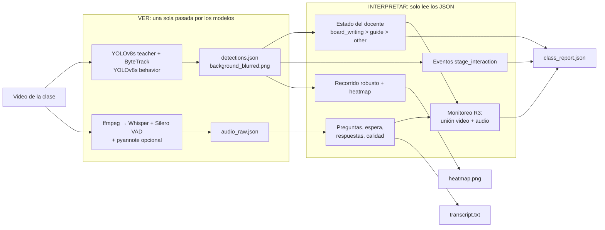

# Espejo

Espejo le devuelve al docente una mirada objetiva de su propia clase. El docente graba la sesión
con un solo celular y recibe un reporte con evidencias (cuánto tiempo monitoreó, cuántas preguntas
hizo y cuánto esperó la respuesta, cuánto escribió en la pizarra, por dónde se movió) alineadas a
las rúbricas de observación de aula del Minedu (Perú).

Este repositorio contiene los módulos de **visión** y **audio** y su **unión**. El reporte en
lenguaje natural con un LLM (`src/espejo/report/`) llegará en la siguiente fase.

La definición exacta de clases, eventos y métricas está en
[`docs/output_contract.md`](docs/output_contract.md), que es la fuente de verdad del código.

## Arquitectura: VER → INTERPRETAR



VER es lo costoso (GPU) y se hace una vez. INTERPRETAR es instantáneo y se puede repetir al
cambiar umbrales: `python scripts/interpret.py --run outputs/<video>/`.

## Modelos

| Modelo | Entrenado por nosotros | Uso |
|---|---|---|
| YOLOv8s teacher | Sí | Encontrar al docente |
| YOLOv8s behavior | Sí | guide, board_writing, answer, stage_interaction |
| ByteTrack | Algoritmo, no modelo | Seguir al docente entre frames |
| Whisper large-v3-turbo | No (preentrenado) | Transcribir: qué se dijo |
| Silero VAD | No (preentrenado) | Cuándo hay voz |
| pyannote speaker-diarization-3.1 | No (preentrenado) | Quién habla |

Resultados de los modelos entrenados (YOLOv8s, 30 épocas, imgsz 640, split val del autor):

| Modelo | Clase | mAP@0.5 | Paper (YOLOv7) |
|---|---|---|---|
| teacher | teacher | 96.3 % | 97.7 % |
| behavior | guide | 82.3 % | 87.0 % |
| behavior | board_writing | 98.5 % | 97.7 % |
| behavior | answer | 91.1 % | — |
| behavior | stage_interaction | 90.3 % | — |

## Clases y métricas

**Video.** Estado del docente por frame, con prioridad `board_writing > guide > other`. Una
conducta se asigna al docente solo si su caja se superpone con la del docente (IoU ≥ 0.3).
`other` no es una clase aprendida: es el relleno. Al docente nunca se le asignan `answer` ni
`stage_interaction`. `stage_interaction` (un alumno pasa al frente) se cuenta como evento.
`answer` se detecta pero no se usa: en el dataset es un alumno de pie, como en las aulas chinas.

`board_writing` implica estar de espaldas a la clase: revisamos 16 recortes al azar de
board_writing del split val y en los 16 el docente estaba de espaldas.

**Audio.** Preguntas del docente (`¿?` o interrogativo al inicio), tiempo de espera hasta la
siguiente voz, respuesta de un alumno dentro de una ventana y tramos de audio dudoso.

| Métrica | Rúbrica | Qué mide |
|---|---|---|
| `board_writing_ratio` | R1 | Tiempo escribiendo en la pizarra, de espaldas a la clase |
| `stage_interaction_count` | R1 | Veces que un alumno pasó al frente |
| `student_response_count`, `response_rate` | R1 | Preguntas respondidas y respuestas / preguntas |
| `teacher_talk_ratio` | R1 | Fracción de la clase en que habla el docente (requiere diarización) |
| `teacher_question_count`, `questions_per_minute` | R2, R3 | Preguntas del docente |
| `mean_wait_time_s`, `median_wait_time_s`, `wait_time_ok_ratio` | R2 | Espera tras preguntar (≥ 3 s, umbral de Rowe) |
| `monitoring_ratio` (+ `_video_` y `_audio_`) | R3 | Unión sin doble conteo de guiar en carpetas (video) y preguntar a la clase hasta la respuesta (audio) |
| `meets_monitoring_threshold` | R3 | Monitorea al menos el 25 % de la sesión, como pide el manual |
| `path_length_normalized` + `heatmap.png` | R4 | Recorrido del docente (evidencia visual) |

`data_quality` informa `teacher_visible_ratio`, saltos descartados del recorrido, proporción de
audio dudoso y si hubo diarización. R5 (comportamiento) depende del lenguaje y la cubrirá el LLM.

## Instalación

Requiere Python 3.11+, ffmpeg y, de preferencia, una GPU NVIDIA.

```bash
conda activate ml_env
pip install -r requirements.txt
pip install -e .
```

`pyannote.audio` 3.x puede intentar actualizar torch. Para conservar tu versión con CUDA,
instálalo fijando torch, por ejemplo con un archivo de restricciones (`torch==2.5.1`,
`torchaudio==2.5.1`) y `pip install -c restricciones.txt "pyannote.audio>=3.3,<4"`.

## Dataset y entrenamiento

```bash
python scripts/inspect_dataset.py --download   # lista el repo, descarga y resume el subconjunto
python scripts/prepare_dataset.py              # data/processed/teacher y data/processed/behavior
python scripts/preview_dataset.py              # cajas dibujadas en outputs/dataset_preview/
python scripts/train.py --dataset teacher
python scripts/train.py --dataset behavior
```

En el repositorio publicado de SCB-Dataset, SCB5-F (docente) y SCB5-D (conductas) vienen
fusionados en un solo subconjunto de 8 clases. Derivamos dos datasets: `teacher` (solo imágenes
con al menos una caja teacher) y `behavior` (solo imágenes con al menos una caja de conducta, 4
clases). Así una imagen sin anotar no le enseña al modelo que el docente o la conducta son fondo.

## Analizar una clase

```bash
python scripts/analyze_class.py --video samples/clase.mp4
python scripts/analyze_class.py --video samples/clase.mp4 --output outputs/ --debug-video
python scripts/analyze_class.py --video samples/clase.mp4 --no-audio
python scripts/interpret.py --run outputs/clase/        # re-interpreta sin correr modelos
```

También funcionan por separado `scripts/analyze_video.py` y `scripts/analyze_audio.py`.
Resultados en `outputs/<video>/`: `detections.json`, `audio_raw.json`, `class_report.json`,
`transcript.txt` y `heatmap.png`. Al terminar se imprime un resumen con las métricas y las
primeras preguntas (minuto, espera y si hubo respuesta).

Recomendación para grabar: celular en horizontal, a unos 2 m de altura, en una esquina del aula y
mirando en diagonal hacia abajo. Es el punto de vista de las cámaras del dataset y reduce las
oclusiones.

Ejemplo (recortado) de `class_report.json`:

```json
{
  "metrics": {
    "monitoring_ratio": {"value": 0.318, "rubric": ["R3"], "description": "Tiempo monitoreando: ...", "note": null},
    "teacher_question_count": {"value": 4, "rubric": ["R2", "R3"], "description": "Preguntas", "note": null},
    "teacher_talk_ratio": {"value": null, "rubric": ["R1"], "description": "...", "note": "sin diarización ..."}
  },
  "audio_events": [
    {"text": "¿Qué creen que pasará con el agua si la calentamos?", "start": "00:04",
     "wait_time_s": 5.0, "wait_time_ok": true, "speaker_known": false, "reliable": true,
     "response": {"start": "00:12", "certainty": "low", "speaker": "unknown"}}
  ]
}
```

`transcript.txt`, listo para el LLM de la siguiente fase:

```
[00:04] DOCENTE: ¿Qué creen que pasará con el agua si la calentamos?
[00:12] ALUMNO: Se evapora.
```

Sin diarización, todas las líneas dicen `HABLANTE`. Los segmentos de baja confianza llevan
`[AUDIO DUDOSO]`.

## Activar pyannote (quién habla)

1. Con tu cuenta de Hugging Face, acepta las condiciones de
   [pyannote/speaker-diarization-3.1](https://huggingface.co/pyannote/speaker-diarization-3.1) y
   [pyannote/segmentation-3.0](https://huggingface.co/pyannote/segmentation-3.0).
2. Crea un token de lectura y guárdalo en un archivo `.env` en la raíz del repo:
   `HF_TOKEN=hf_...` (`.env` está en `.gitignore`; nunca lo subas).
3. Deja `diarization.enabled: true` en [`configs/audio.yaml`](configs/audio.yaml).

Si falta algo, el análisis sigue sin diarización y el reporte indica el motivo.

## Privacidad

No se guardan frames ni recortes de personas: solo coordenadas, el heatmap sobre un fondo
desenfocado al punto de que no se reconoce a nadie y, si se pide, el video de depuración (en
`outputs/`, ignorado por git). No hay reconocimiento facial ni de emociones.

## Limitaciones

1. **El mAP es optimista.** El autor dividió train/val por imágenes, no del todo por video: según
   el prefijo de los nombres, el 26 % de las imágenes de val viene de un video que también está
   en train. En videos nuevos el rendimiento será menor.
2. **Dominio distinto.** SCB-Dataset son aulas chinas (uniformes, distribución, cámaras fijas en
   alto). En aulas peruanas y con celular, el rendimiento puede bajar.
3. **`answer` descartado.** En el dataset un alumno responde de pie; en el Perú se responde
   sentado. Las respuestas se miden con el audio.
4. **Monitoreo sin diarización es menos preciso.** Sin saber quién habla se cuentan las preguntas
   de cualquier persona y cualquier voz posterior cuenta como posible respuesta.

## Mejoras futuras

- Marcar una vez la zona de carpetas en el primer frame, para distinguir mejor guiar en carpetas
  de estar al frente.
- Entrenar la orientación del docente (de frente o de espaldas) con supervisión débil, usando
  `board_writing` como señal de "de espaldas".

## Tests y calidad

```bash
pytest
ruff format .
ruff check .
```

Los tests cubren la lógica pura (asignación del estado del docente, prioridades, unión del
monitoreo, respuestas con y sin diarización, wait time, recorrido robusto, preguntas, calidad y
métricas) y no necesitan modelos, GPU ni audio real.

## Estructura

```
configs/            vision.yaml, audio.yaml, analysis.yaml y YAML de los datasets
docs/               output_contract.md (fuente de verdad) y manual de rúbricas
scripts/            analyze_class, interpret, analyze_video, analyze_audio, dataset y train
src/espejo/
  config.py         configuración en dataclasses tipadas
  common/           rutas, JSON, mm:ss, secretos (.env) y convivencia de librerías CUDA
  dataset/          descarga, inspección, preparación y preview de SCB-Dataset
  training.py       entrenamiento y evaluación de los detectores
  vision/           VER (detection_run) e INTERPRETAR (interpretation) del video
  audio/            VER (capture) e INTERPRETAR (interpretation) del audio
  analysis/         unión: monitoreo, métricas por rúbrica, class_report y transcript
tests/              tests de la lógica pura
```

## Dataset y licencia

Los modelos se entrenan con **SCB-Dataset**:

> Fan Yang. *SCB-Dataset: A Dataset for Detecting Student and Teacher Classroom Behavior*.
> arXiv:2304.02488, 2023. https://arxiv.org/abs/2304.02488

SCB-Dataset es **solo para uso académico** y no se redistribuye. Este repositorio no incluye
imágenes, etiquetas ni pesos entrenados: cada persona debe descargarlo desde
[Hugging Face](https://huggingface.co/datasets/wintonYF/SCB-Dataset) y aceptar sus condiciones.
