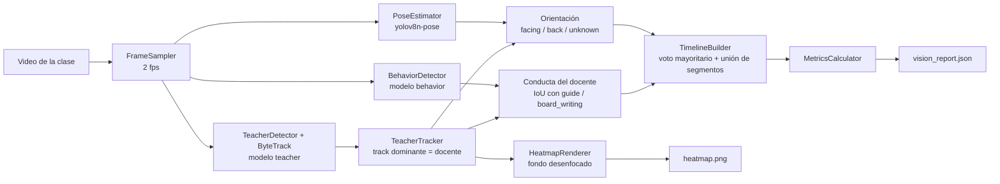

# Espejo

Espejo le devuelve al docente una mirada objetiva de su propia clase. El docente graba la sesión
con su celular y recibe un reporte con evidencias (cuánto tiempo monitoreó a sus alumnos, cuánto
escribió en la pizarra, por dónde se movió en el aula) alineadas a las rúbricas de observación de
aula del Minedu (Perú).

Este repositorio contiene el **módulo de visión**. Los módulos de audio (`src/espejo/audio/`) y de
reporte con LLM (`src/espejo/report/`) se agregarán en las siguientes fases.

## Pipeline de visión



Cada etapa es una clase en su propio módulo dentro de `src/espejo/vision/`. Todos los umbrales
viven en [`configs/vision.yaml`](configs/vision.yaml).

| Etapa | Qué hace |
|---|---|
| `FrameSampler` | Lee el video con OpenCV y entrega frames a `sample_fps`. |
| `TeacherTracker` | Sigue a las cajas "teacher" con ByteTrack y elige el track que aparece en más frames. Si en un frame falta, acepta otra caja "teacher" solo con confianza alta. |
| `BehaviorDetector` | Detecta conductas en el frame completo. Asigna `guide` o `board_writing` al docente si el IoU con su caja es ≥ 0.3. `answer` y `stage_interaction` se cuentan como señal de participación. |
| `orientation.py` | Con los keypoints del docente: cara visible → `facing`; solo hombros → `back`; si no, `unknown`. |
| `TimelineBuilder` | Suaviza con voto mayoritario (ventana de 3 s) y une segmentos menores a 1.5 s. |
| `MetricsCalculator` | Ratios de monitoreo, pizarra y espalda; recorrido; cobertura del aula; participación. |
| `HeatmapRenderer` | Mapa de calor del recorrido sobre el primer frame con un desenfoque gaussiano fuerte. |

### Métricas

- `analyzed_duration_s` y `teacher_visible_ratio`.
- `monitoring_ratio`: tiempo en `guide` / duración analizada.
- `meets_monitoring_threshold`: `monitoring_ratio >= 0.25`. La rúbrica "Evalúa el progreso de los
  aprendizajes" pide monitorear activamente al menos el 25 % de la sesión.
- `board_writing_ratio` y `back_to_class_ratio`.
- `path_length_normalized`: recorrido del docente medido en anchos de frame.
- `room_coverage_ratio`: fracción de celdas de una grilla de 8x6 que el docente visitó.
- `student_participation_events`: detecciones de `answer` y `stage_interaction` (sin identificar alumnos).

### Privacidad

No se guardan frames ni recortes de personas. La única imagen que se genera es el heatmap, con el
fondo desenfocado al punto de que no se reconoce a nadie. El video de depuración es opcional y se
guarda en `outputs/`, que no se sube al repositorio. No hay reconocimiento facial ni de emociones.

## Instalación

Requiere Python 3.11 o superior y, de preferencia, una GPU NVIDIA con CUDA.

```bash
conda activate ml_env            # o el entorno que uses
pip install -r requirements.txt
pip install -e .                 # instala el paquete espejo en modo editable
```

## Dataset

```bash
python scripts/inspect_dataset.py --download   # lista el repo, descarga y resume el subconjunto
python scripts/prepare_dataset.py              # genera data/processed/teacher y data/processed/behavior
python scripts/preview_dataset.py              # dibuja cajas en outputs/dataset_preview/
```

En el repositorio publicado de SCB-Dataset, los subconjuntos SCB5-F (docente) y SCB5-D (conductas)
vienen fusionados en `SCB5_Teacher_Behavior_Stand_BlackBoard_Sreen_20250406`: 8 clases, formato
YOLO, con splits train/val del autor. A partir de él derivamos dos datasets independientes:

| Dataset | Clases | Imágenes que se conservan |
|---|---|---|
| `teacher` | 0 = teacher | solo las que tienen al menos una caja `teacher` |
| `behavior` | 0 = guide, 1 = board_writing, 2 = answer, 3 = stage_interaction | solo las que tienen al menos una caja de conducta |

Filtrar así evita que una imagen sin anotar le enseñe al modelo que el docente o la conducta son
fondo. Las clases `stand`, `screen` y `blackBoard` se descartan.

## Entrenamiento

```bash
# Prueba de humo: 1 época con el 5 % de los datos
python scripts/train.py --dataset teacher --epochs 1 --fraction 0.05 --name smoke_teacher --no-export

# Entrenamiento completo (yolov8s preentrenado, 30 épocas, batch automático)
python scripts/train.py --dataset teacher
python scripts/train.py --dataset behavior
```

Cada corrida se guarda en `runs/<dataset>/`, deja el mAP@0.5 por clase en
`runs/<dataset>/per_class_map50.json` y copia el mejor modelo a `weights/<dataset>.pt`.
Si la GPU se queda sin memoria, usa `--batch 8`.

## Analizar un video

```bash
python scripts/analyze_video.py --video samples/clase.mp4
python scripts/analyze_video.py --video samples/clase.mp4 --output outputs/ --debug-video
```

Genera `outputs/<nombre_video>/vision_report.json` y `outputs/<nombre_video>/heatmap.png`, e
imprime un resumen en consola. Para probar el flujo sin pesos entrenados:

```bash
python scripts/analyze_video.py --video samples/clase.mp4 \
    --teacher-weights yolov8s.pt --teacher-class person --behavior-weights yolov8s.pt
```

### Ejemplo de salida

Estructura de `vision_report.json` (valores ilustrativos):

```json
{
  "metadata": {
    "video": "clase.mp4",
    "duration_s": 149.8,
    "duration": "02:30",
    "native_fps": 30.0,
    "resolution": {"width": 1920, "height": 1080},
    "sample_fps": 2.0,
    "models": {
      "teacher": "teacher.pt",
      "teacher_class": "teacher",
      "behavior": "behavior.pt",
      "pose": "yolov8n-pose.pt",
      "tracker": "bytetrack.yaml"
    }
  },
  "behavior_timeline": [
    {"label": "board_writing", "start_s": 0.0, "end_s": 41.5, "start": "00:00", "end": "00:42", "duration_s": 41.5},
    {"label": "guide", "start_s": 41.5, "end_s": 88.0, "start": "00:42", "end": "01:28", "duration_s": 46.5}
  ],
  "orientation_timeline": [
    {"label": "back", "start_s": 0.0, "end_s": 39.0, "start": "00:00", "end": "00:39", "duration_s": 39.0},
    {"label": "facing", "start_s": 39.0, "end_s": 149.8, "start": "00:39", "end": "02:30", "duration_s": 110.8}
  ],
  "metrics": {
    "analyzed_duration_s": 149.8,
    "teacher_visible_ratio": 0.953,
    "monitoring_ratio": 0.31,
    "meets_monitoring_threshold": true,
    "board_writing_ratio": 0.277,
    "back_to_class_ratio": 0.26,
    "path_length_normalized": 3.42,
    "room_coverage_ratio": 0.271,
    "student_participation_events": 18,
    "analyzed_duration": "02:30"
  }
}
```

## Tests y calidad

```bash
pytest
ruff format .
ruff check .
```

Los tests cubren la lógica pura (geometría, orientación, timeline, métricas y selección del
docente) y no necesitan modelos ni GPU.

## Estructura

```
configs/            umbrales del pipeline y YAML de los datasets
scripts/            puntos de entrada delgados (CLI)
src/espejo/
  config.py         carga de la configuración en dataclasses tipadas
  training.py       entrenamiento y evaluación de los detectores
  dataset/          descarga, inspección, preparación y preview de SCB-Dataset
  vision/           etapas del pipeline de visión
tests/              tests de la lógica pura
```

## Dataset y licencia

Los modelos se entrenan con **SCB-Dataset**:

> Fan Yang. *SCB-Dataset: A Dataset for Detecting Student and Teacher Classroom Behavior*.
> arXiv:2304.02488, 2023. https://arxiv.org/abs/2304.02488

SCB-Dataset es **solo para uso académico** y no se redistribuye. Por eso este repositorio no
incluye imágenes, etiquetas ni pesos entrenados: cada persona debe descargarlo desde
[Hugging Face](https://huggingface.co/datasets/wintonYF/SCB-Dataset) con `scripts/inspect_dataset.py`
y aceptar sus condiciones de uso.
